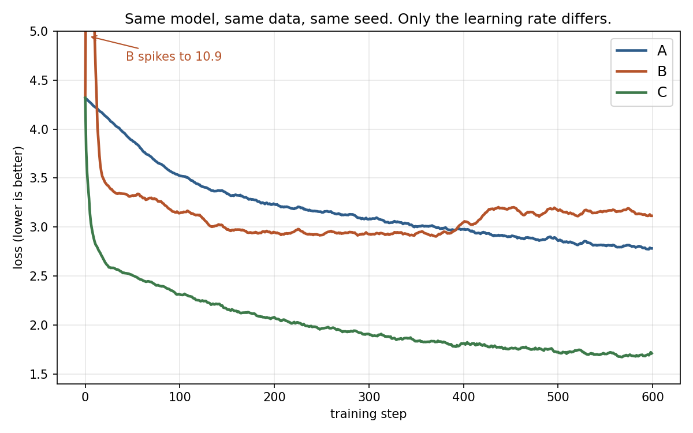

# Learning rate quiz

Three copies of the same tiny GPT learn to write Shakespeare, one character at a time.
Same data, same seed, same batches, same 600 steps. **Only the learning rate differs.**



**Quiz:** the three learning rates were `0.1`, `0.003` and `0.00003`. Which curve is A, B and C?
Think first, then open [answer.png](answer.png).

## Run it

```bash
pip install -r requirements.txt
python train.py --lr 0.003     # one run, about 3 minutes on a laptop CPU
python quiz.py                 # all three runs + quiz.png and answer.png
```

`train.py` downloads Tiny Shakespeare (1.1 MB) on the first run and checks its hash. Each run writes
`runs/lr_<lr>.json` with the train loss per step, the validation loss every 25 steps, and a text sample.

The model: 3 transformer blocks, 128-wide, 4 heads, 64-character context, about 0.6 M parameters, AdamW.

## What the curves mean

| Run | Learning rate | Final val loss | What happened |
|---|---|---|---|
| A | 0.00003 | 2.82 | Steps too small. Still creeping down after 600 steps. |
| B | 0.1 | 3.17 | Steps too big. Loss jumps to 10.9, recovers to ~2.9, then climbs back up. |
| C | 0.003 | 1.87 | Big enough to move fast, small enough to keep improving. |

Text each model writes after training (prompt `ROMEO:`):

- **C (0.003):** `Threehis know self Warwick eardon, in I tlet, greep upon his there.`
- **B (0.1):** `tl remhfed hewTselteeloHTa neaman yaid IgelsteegMn`

## Your task

Find the **highest learning rate that still trains well** (final val loss below 2.0 in 600 steps).
Try values between 0.003 and 0.1, for example:

```bash
python train.py --lr 0.01
```

Post your best learning rate, its final val loss, and your curve in the community.
